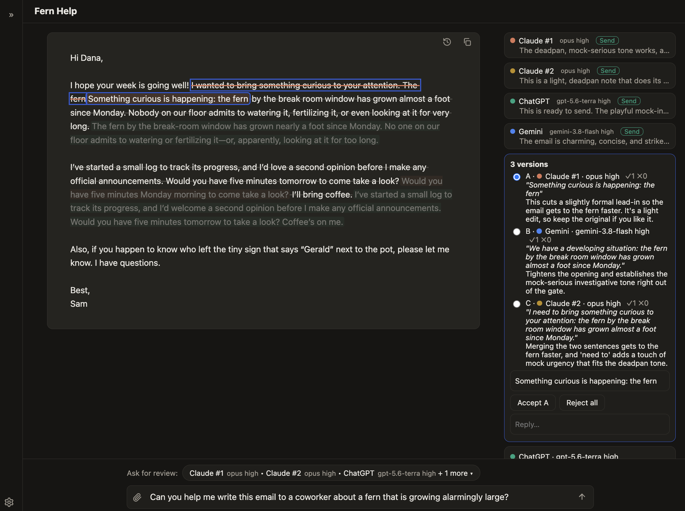

# Consensus

Consensus puts Claude, ChatGPT, and Gemini on the same draft. Each reviewer proposes tracked changes with a reason; you accept, reject, edit, or reply, and the reviewers weigh in on each other's proposals in the next round.

One model's edits carry one model's blind spots. Consensus replaces copying text between three chat tabs with one document and a margin full of competing suggestions.



## How it works

1. **Start a doc.** Paste your draft and write a brief: what the piece does, who reads it, and any limits.
2. **Pick reviewers.** Add any mix of providers and models, including several of the same one. Give each reviewer a name and its own instructions, such as "Check every claim against the brief" for one and "Fix grammar only" for another.
3. **Send a round.** Every reviewer reads the doc in parallel and returns a verdict, an overall note, and proposals anchored to exact passages.
4. **Decide.** Proposals appear as strike-and-insert marks in the text and as cards in the margin. When reviewers rewrite the same passage, one card shows every version side by side. Accept one, reject them all, or edit the wording before you accept.
5. **Go again.** In the next round, reviewers agree or disagree with each other's open proposals. Taste disagreements get tagged **Your call** instead of looping.

History keeps a snapshot of every round, and **Copy** puts clean text on the clipboard, ready for an email.

## Requirements

Consensus runs each model through its official command-line tool, signed in the way you already use it. It holds no API keys, and every call counts against the account behind that CLI, under that provider's terms.

- Node.js (tested on 24)
- One or more of:
  - Claude Code: `curl -fsSL https://claude.ai/install.sh | bash`, then run `claude` and `/login`
  - Codex CLI: `npm i -g @openai/codex`, then `codex login`
  - Antigravity CLI: `curl -fsSL https://antigravity.google/cli/install.sh | bash`, then run `agy` once to sign in

Consensus has only been tested on macOS.

## Setup

```bash
npm install
npm run build
npm link
consensus
```

The app opens at http://localhost:4747. Pass `--port` to use another port, or `--no-open` to skip opening the browser.

**Settings** (the gear, bottom left) edits the shared system prompt and the default model for each provider. A reviewer keeps the prompt it started with; changes apply to reviewers you add afterward.

Your data stays on your machine in `~/.consensus`: threads as plain JSON, prompt snapshots, and attachments.

## Security

Consensus listens on 127.0.0.1 only and rejects requests from other origins. The CLIs it drives can still act on what they read:

- **Web access.** Every reviewer can search the web and open pages, so a page or a pasted document can carry instructions that steer a model, including instructions to send text to another site. Each reply lists the pages it opened under **Sources**.
- **Local files.** Codex runs in a read-only sandbox. Gemini runs with `--dangerously-skip-permissions`, limited to web reading, web search, and `view_file`. `view_file` can read any file your user account can read, so a hostile page could get Gemini to read a local file and quote it back.

Review only material you would paste into the providers' own apps, and leave Gemini out of rounds on untrusted content if local files concern you.

## Development

```bash
npm run dev:server   # API on :4747
npm run dev:web      # UI on :5173 with hot reload
npm test             # unit tests, no model calls
npm run typecheck
npm run smoke        # live check against the real CLIs; uses a little quota
```

Run `npm run smoke` after upgrading any of the three CLIs. Design notes live in `docs/superpowers/specs`.

## License

[MIT](LICENSE)
